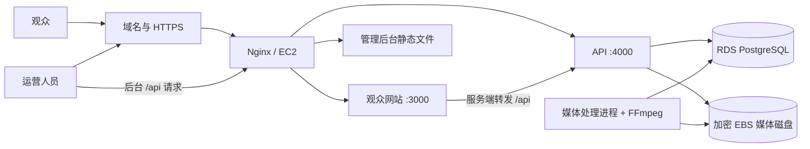

# AWS 海外站点部署手册

版本：v1.0  
编写日期：2026-11-23  
适用项目：Red Video 短剧网站  
目标读者：负责执行部署、但不熟悉服务器的同事

> 本手册根据当前仓库代码编写，提供一套单区、单台 EC2 的起步部署方法。当前版本尚无 Docker 部署文件，也没有把视频接入 S3 或 CDN；视频、封面和转码文件保存在 EC2 挂载的持久磁盘中。此方案适合小流量试运行，单台服务器故障时网站会暂时不可用。正式开放前请先完成第 1 节列出的开发检查。

## 1. 部署前先确认

### 1.1 当前程序包含什么

本项目有三个需要运行的部分：

| 部分 | 运行方式 | 用途 |
| --- | --- | --- |
| 观众网站 | Next.js 服务，监听本机 3000 端口 | 短剧首页、分类、详情和播放页 |
| 管理后台 | Vite 构建成静态文件，由 Nginx 提供 | 管理短剧、上传视频、发布内容 |
| API 和媒体处理 | NestJS API 监听本机 4000 端口；另有一个媒体处理进程 | 数据、登录、上传、转码和视频读取 |
| 数据库 | AWS RDS for PostgreSQL | 管理账号、短剧、分集和发布数据 |
| 媒体磁盘 | EC2 连接的加密 EBS 磁盘 | 保存源视频、转码视频、试看片段和封面 |



推荐用两个域名：`www.example.com`（观众网站）和 `admin.example.com`（管理后台）。两者都指向同一台 EC2。数据库只允许该 EC2 访问。网站和 API 的 3000、4000 端口只监听服务器本机，不直接暴露给互联网。

### 1.2 上线前必须由开发人员处理的事项

1. **修正或隔离管理后台登录限流。** 当前 API 按 TCP 连接来源地址计数登录尝试，且每 10 分钟最多 10 次。经 Nginx 代理后 API 看到的连接来源通常是本机地址，所有人的登录可能共用同一个计数。开发人员应让限流安全地使用可信代理传入的真实来源地址，或在后台入口增加可靠的访问限制。相关实现见 [auth.ts](../backend/api/src/auth.ts)。完成前不要把后台登录页面不加限制地公开给互联网。
2. **确认管理员账号恢复办法。** 当前没有后台改密或找回密码页面。首次创建账号时会在终端一次性显示随机密码；必须将密码存入公司密码管理器，并确认负责人知道发生遗失时由谁处理。
3. **确认媒体容量与备份负责人。** 当前媒体文件不会自动清理；`MEDIA_UPLOAD_DAYS` 只影响未完成上传的续传期限，不代表服务器会自动删除媒体文件。请预估媒体量、设置 EBS 快照并安排磁盘检查，详见第 12 节。媒体存储说明见 [本地媒体处理](local-media.md)。
4. **开发人员须用正式发布版本确认数据库迁移和 FFmpeg 转码。** 本机技术版本基线记录 PostgreSQL 18.7、FFmpeg 9.0.2；AWS 区域可选版本和 Ubuntu 软件源可能不同。上线前需在目标环境确认迁移、上传、转码、封面和播放均可用。

当前程序把视频直接从 EC2 API 服务器发给观众，没有 S3/CloudFront 对象存储或 CDN 配置。视频访问量增加后，EC2 带宽、磁盘和费用都可能成为瓶颈；接入 S3/CloudFront 需要开发人员先改造程序，不能只在 AWS 控制台创建一个 S3 桶就让程序自动使用。

### 1.3 部署前需要准备的资料

请让项目负责人或开发人员提供以下内容。缺少这些资料时，不要自行猜测：

| 资料 | 示例 | 提供人 |
| --- | --- | --- |
| AWS 账号及获授权的部署账号 | AWS 控制台登录方式 | AWS 管理员 |
| AWS 区域 | 以目标用户所在区域和业务要求为准 | 项目负责人 |
| 域名管理权限 | `example.com` 的 DNS 管理账号 | 域名管理员 |
| 正式代码版本 | Git 标签，例如 `v1.0.0`，或开发人员交付的发布包 | 开发人员 |
| 代码仓库只读访问方式 | 仓库地址及可撤销的部署密钥 | 开发人员 |
| 预算上限及收件邮箱 | 每月可接受的 AWS 费用上限 | 项目负责人 |
| 预计媒体数据量 | 上线视频的原始文件总容量及月增长量 | 内容运营负责人 |
| 管理员初始账号负责人 | 接收并保管一次性密码的人 | 项目负责人 |

AWS 资源价格会随区域、规格、存储和对外流量变化。创建前请用 [AWS 定价计算器](https://calculator.aws/)估算 EC2、RDS、EBS、快照、Elastic IP/公网 IPv4 和数据传出费用，并先设置预算提醒。

## 2. AWS 账号、区域与费用提醒

1. 由 AWS 管理员登录 [AWS 管理控制台](https://console.aws.amazon.com/)；开启根账号多因素验证（MFA）。日常操作使用获授权的部署账号或角色，不共用根账号密码。
2. 在控制台右上角选择计划部署的区域。EC2、RDS、EBS 和快照应放在同一区域。区域选择应考虑主要观众位置、业务数据存放要求，以及该区域是否提供所需 EC2/RDS 规格。
3. 打开 **Billing and Cost Management → Budgets**，创建每月成本预算，并添加项目负责人和财务负责人的邮箱。建议在预算的 50%、80%、100% 设置邮件提醒。AWS Budget 是费用提醒，不是硬性消费上限；收到提醒后仍需登录控制台检查资源。创建步骤见 [AWS Budgets 官方说明](https://docs.aws.amazon.com/cost-management/latest/userguide/budgets-create.html)。

## 3. 创建服务器安全组

安全组相当于 AWS 云端防火墙。只开放网站确实需要的端口，不要为了“方便”开放所有端口。

1. 在控制台搜索 **EC2 → Security Groups → Create security group**。
2. 名称填写 `red-video-ec2-sg`，VPC 选择稍后 EC2 和 RDS 共用的 VPC（新项目可先使用默认 VPC）。
3. 入站规则设置如下：

| 类型 | 端口 | 来源 | 用途 |
| --- | ---: | --- | --- |
| HTTP | 80 | `0.0.0.0/0` | 网站跳转 HTTPS、申请证书 |
| HTTPS | 443 | `0.0.0.0/0` | 全球观众和后台的加密访问 |
| SSH | 22 | 不添加 | 优先使用 AWS Systems Manager Session Manager 管理服务器 |

如果网站也要支持 IPv6，请由 AWS 管理员另行添加对应 IPv6 来源规则。**不要开放 3000、3001、4000、5432 端口到互联网。** AWS 对安全组的说明也建议不要将 SSH 来源设为所有 IP：[EC2 安全组官方说明](https://docs.aws.amazon.com/AWSEC2/latest/UserGuide/creating-security-group.html)。

如暂时无法使用 Session Manager，只能由 AWS 管理员临时添加 SSH 22 端口，并把来源限制为部署人员当前固定公网 IP 的 `/32`；完成配置后立即删除该规则。不要使用 `0.0.0.0/0` 作为 SSH 来源。

## 4. 创建 EC2 服务器

EC2 是运行网站程序的云端服务器。

1. 在 **EC2 → Instances → Launch instances** 创建实例。
2. 建议设置：
   - 名称：`red-video-prod`
   - 系统镜像：Ubuntu Server 24.04 LTS，64 位 x86 架构
   - 实例规格：起步建议至少 2 vCPU、8 GiB 内存；例如所选区域提供的 `m7i.large` 或同级规格。媒体转码会占用 CPU，实际规格须按并发访问和转码量调整。
   - 根磁盘：加密 EBS，至少 30 GiB；代码、系统和构建缓存放在根磁盘。
   - 网络：选择上一步的 `red-video-ec2-sg`，启用公网 IPv4。
   - IAM 实例角色：附加包含 `AmazonSSMManagedInstanceCore` 权限的角色，以便通过 Session Manager 登录，不必向互联网开放 SSH。Session Manager 需要实例具备相应 IAM 角色和 SSM 管理能力，见 [AWS 连接 EC2 官方说明](https://docs.aws.amazon.com/AWSEC2/latest/UserGuide/connect-with-systems-manager-session-manager.html)。
3. 创建并启动实例后，在 **EC2 → Network & Security → Elastic IPs → Allocate Elastic IP address** 分配弹性 IP，再通过 **Actions → Associate Elastic IP address** 关联到此实例。之后 DNS 使用此 IP；不要使用可能随停止/启动改变的临时公网 IP。Elastic IP 和 Route 53 配置说明见 [Route 53 指向 EC2](https://docs.aws.amazon.com/Route53/latest/DeveloperGuide/routing-to-ec2-instance.html)。
4. 记录实例 ID、区域、VPC、安全组 ID、可用区和 Elastic IP。后续 RDS 要使用相同 VPC；EBS 媒体磁盘必须位于实例所在可用区。
5. 在 EC2 控制台选择实例 → **Connect → Session Manager → Connect** 打开服务器终端。若 Session Manager 选项不可用，先让 AWS 管理员检查 IAM 实例角色和 Systems Manager 状态，不要立刻开放 SSH 给所有人。

AWS 官方也提供控制台创建实例的详细步骤：[启动 EC2 实例](https://docs.aws.amazon.com/AWSEC2/latest/UserGuide/LaunchingAndUsingInstances.html)。

## 5. 创建 PostgreSQL 数据库

RDS 负责托管数据库。数据库设置为私有，只让 EC2 服务器访问。

1. 在 **RDS → Databases → Create database** 选择 **Standard create** 和 **PostgreSQL**。
2. 版本选择 PostgreSQL 18.x。AWS 当前版本列表中有 18.6；如果所选区域没有 18.x，或控制台只提供其他主版本，请先让开发人员确认兼容性，不要擅自选版本。可查看 [RDS PostgreSQL 版本列表](https://docs.aws.amazon.com/AmazonRDS/latest/PostgreSQLReleaseNotes/postgresql-versions.html)。
3. 起步资源可选 2 vCPU、至少 2–4 GiB 内存和加密 gp3 存储（数据库存储可从 20 GiB 起步）；最终规格和容量以 AWS 价格估算、数据量及压力验证为准。业务要求故障时快速切换的生产环境应评估 Multi-AZ；单可用区部署成本较低，但不提供同等的可用性。
4. 设置唯一的数据库实例标识，例如 `red-video-db`。主用户名和主密码由 AWS 管理员保管，建议在创建向导中由 AWS Secrets Manager 管理主密码。不要把主密码用于网站程序。
5. **Connectivity（连接）**：
   - 选择与 EC2 相同的 VPC。
   - 若向导提供 **Connect to an EC2 compute resource**，选择 `red-video-prod`，并检查 AWS 自动配置的安全组。
   - **Public access 设为 No**。
   - 数据库安全组入站仅允许 TCP 5432，来源为 `red-video-ec2-sg`（EC2 安全组本身），不允许 `0.0.0.0/0`，也不要填写部署人员电脑公网 IP。
6. **Additional configuration**：初始数据库名可留空；稍后创建项目专用数据库。开启自动备份，保留期建议至少 7 天；开启存储加密。RDS 自动备份可以在保留期内恢复到某个时间点，保留期可设置 1–35 天，详细说明见 [RDS 备份与恢复](https://docs.aws.amazon.com/AmazonRDS/latest/gettingstartedguide/managing-backup-restore.html)。
7. 创建后等待状态变为 **Available**。在 **Connectivity & security** 记录端点（Endpoint）和端口（通常是 5432），并再次确认 **Publicly accessible = No**。

AWS 的 PostgreSQL 创建和连接流程见 [创建 RDS PostgreSQL 实例](https://docs.aws.amazon.com/AmazonRDS/latest/UserGuide/USER_CreateDBInstance.html) 与 [连接 RDS PostgreSQL](https://docs.aws.amazon.com/AmazonRDS/latest/UserGuide/USER_ConnectToPostgreSQLInstance.html)。

### 5.1 创建项目专用数据库账号

在 EC2 终端中执行以下操作，不要从个人电脑直接连接公开数据库：

1. 安装 PostgreSQL 客户端：

   ```bash
   sudo apt update
   sudo apt install -y postgresql-client openssl
   ```

2. 为程序账号生成独立密码，并放入公司密码管理器：

   ```bash
   openssl rand -hex 32
   ```

   复制显示的 64 位十六进制字符串，之后 SQL 和 `.env` 都使用同一个值。不要把它贴到聊天、工单或代码仓库。

3. 用 RDS 主账号连接。把端点和主用户名替换为 RDS 控制台显示的值；系统会提示输入主密码：

   ```bash
   psql --no-readline "host=替换为RDS端点 port=5432 dbname=postgres user=替换为RDS主用户名 sslmode=require"
   ```

4. 进入 `postgres=>` 提示符后，执行下面两行，把密码占位内容替换为刚生成的值：

   ```sql
   CREATE ROLE red_video_app LOGIN PASSWORD '粘贴64位十六进制密码';
   CREATE DATABASE red_video OWNER red_video_app;
   ```

   然后输入 `\q` 退出。不要在单引号中加入其他字符。

如果连接超时，先检查 EC2 与 RDS 是否在同一 VPC、RDS 安全组是否允许 EC2 安全组访问 5432、RDS 是否已变为 Available。不要通过把数据库改成公开访问来绕过问题。

## 6. 创建并挂载媒体磁盘

数据库备份不会备份视频文件，所以媒体盘必须单独备份。媒体磁盘容量按“预计保留的原始视频总量 × 至少约 2，再加增长空间”估算；这是起步估算，不是容量保证。程序保存源视频和处理结果，也会保留封面及上传临时文件。磁盘不够时上传和转码会失败。

1. 在 **EC2 → Elastic Block Store → Volumes → Create volume** 创建加密 gp3 卷。选择与 EC2 完全相同的可用区，容量按上面的估算填写；添加标签 `Name=red-video-media`、`Backup=red-video`。
2. 创建后选择卷，点 **Actions → Attach volume**，附加到 `red-video-prod`。EC2 与 EBS 卷必须在同一可用区；控制台操作见 [EBS 附加卷官方说明](https://docs.aws.amazon.com/ebs/latest/userguide/ebs-attaching-volume.html)。
3. 在服务器终端执行：

   ```bash
   lsblk -f
   ```

   找到刚附加、尚未挂载的新磁盘。设备名常见为 `/dev/nvme1n1`，但实际名称以 `lsblk` 为准。**如果设备已有文件系统或数据，停止并联系 AWS 管理员，不要格式化。** `mkfs` 会清空所选磁盘。

4. 只有在确认这是新建的空磁盘后，才将示例设备名替换为实际设备名并格式化：

   ```bash
   sudo mkfs -t ext4 /dev/nvme1n1
   sudo mkdir -p /srv/red-video-media
   sudo blkid /dev/nvme1n1
   ```

5. `blkid` 会显示 UUID。复制 UUID，执行 `sudo nano /etc/fstab`，在文件末尾增加一行（将 UUID 替换为实际值）：

   ```text
   UUID=实际UUID /srv/red-video-media ext4 defaults,nofail 0 2
   ```

6. 保存后挂载并检查容量：

   ```bash
   sudo mount -a
   df -h /srv/red-video-media
   ```

   `df` 应显示刚创建的媒体盘容量。如果出现错误，不要重启服务器，先请管理员检查 `/etc/fstab`。

## 7. 配置域名

建议域名记录如下，IP 都填写 EC2 的 Elastic IP：

| 记录类型 | 主机记录 | 指向 | 用途 |
| --- | --- | --- | --- |
| A | `www` | EC2 Elastic IP | 观众网站 |
| A | `admin` | EC2 Elastic IP | 管理后台 |

如果还要让裸域名 `example.com` 可访问，再添加根域名 A 记录。DNS 可在 Route 53 或当前域名服务商维护；不在 Route 53 时不用变更域名注册商的托管方式，只需添加以上 A 记录。如果准备把 DNS 改由 Route 53 管理，需先创建公共托管区域，再把该区域给出的 NS 记录填入域名注册商，否则新区域的记录不会生效。Route 53 控制台添加记录可参考 [官方说明](https://docs.aws.amazon.com/Route53/latest/DeveloperGuide/routing-to-ec2-instance.html)。

等待 DNS 生效后，在浏览器打开 `http://www.example.com` 和 `http://admin.example.com`。此时 HTTP 页面可能还没有 HTTPS 锁标志，继续完成第 10 节后再验收。

## 8. 安装运行环境并取得正式代码

以下示例使用 Ubuntu、项目技术基线 Node.js 24.22.3、pnpm 10.34.8。不要把开发分支或临时工作区直接部署到生产环境。

### 8.1 系统软件

先在 EC2 终端执行：

```bash
sudo apt update
sudo apt upgrade -y
sudo apt install -y git curl ca-certificates nginx ffmpeg postgresql-client openssl
```

安装后检查：

```bash
ffmpeg -version
ffprobe -version
ffmpeg -hide_banner -encoders | grep libx264
```

若最后一条命令没有显示 `libx264`，先联系开发人员处理 FFmpeg 安装；当前媒体转码会使用 H.264 编码器。生产版本使用的 FFmpeg 需经开发人员确认与本项目兼容。

### 8.2 建立专用程序账号并安装 Node.js

网站进程不应以 root 账号运行。执行：

```bash
sudo adduser --disabled-password --gecos "" redvideo
sudo mkdir -p /opt/red-video
sudo chown -R redvideo:redvideo /opt/red-video
sudo mkdir -p /srv/red-video-media
sudo chown redvideo:redvideo /srv/red-video-media
```

切换到程序账号，并安装项目要求的 Node.js：

```bash
sudo -iu redvideo
curl -o- https://raw.githubusercontent.com/nvm-sh/nvm/v0.40.3/install.sh | bash
source ~/.bashrc
nvm install 24.22.3
corepack enable
node --version
```

预期 Node 版本为 `v24.22.3`。若 `corepack` 不存在，停止并联系开发人员，不要用系统自带的旧 Node/pnpm 继续安装。

### 8.3 下载固定发布版本

请开发人员提供代码仓库地址和正式版本标签，例如 `v1.0.0`。保持在 `redvideo` 账号下执行。替换两项示例值后再运行：

```bash
cd /opt/red-video
git clone --branch v1.0.0 https://替换为开发人员提供的仓库地址 .
corepack pnpm --version
```

在项目根目录执行版本检查，预期为 `10.34.8`；仓库的 `packageManager` 字段会让 Corepack 选用项目锁定的 pnpm 版本。

如果代码仓库要求密钥，使用仅能读取该仓库、可随时撤销的部署密钥；不要把个人账号密码或访问令牌写进命令行、脚本或仓库地址。若开发人员交付的是发布压缩包，按其提供的解压说明将文件放入 `/opt/red-video`。

## 9. 设置程序配置并构建

### 9.1 设置生产环境变量

保持在程序账号下，执行：

```bash
nano /opt/red-video/backend/api/.env
```

写入以下内容，并替换所有示例值：

```dotenv
DATABASE_URL="postgresql://red_video_app:替换为64位十六进制密码@替换为RDS端点:5432/red_video?schema=public&sslmode=require"
PORT=4000
ADMIN_ORIGIN="https://admin.example.com"
MEDIA_STORAGE_DIR="/srv/red-video-media"
MEDIA_MAX_FILES=50
MEDIA_MAX_BYTES=1073741824
MEDIA_CHUNK_BYTES=5242880
MEDIA_UPLOAD_DAYS=7
```

检查要点：

- RDS 端点只填写主机名，不加 `https://`。
- `ADMIN_ORIGIN` 必须与后台浏览器地址完全一致：使用 HTTPS、准确的主机名，不加结尾斜线或路径。
- 程序账号密码使用刚生成的十六进制密码，这种格式不需要额外 URL 编码。
- `MEDIA_STORAGE_DIR` 必须是媒体盘挂载路径，不能使用项目代码目录或临时目录。
- `.env` 含数据库口令，不能提交或发送给其他人。保存后执行：

  ```bash
  chmod 600 /opt/red-video/backend/api/.env
  ```

### 9.2 安装依赖、迁移数据库、构建应用

仍以 `redvideo` 账号执行：

```bash
cd /opt/red-video
corepack pnpm install --frozen-lockfile
corepack pnpm api:build
corepack pnpm db:migrate
corepack pnpm admin:build
API_PROXY_TARGET=http://127.0.0.1:4000 corepack pnpm frontend:build
```

`db:migrate` 会按仓库中的正式迁移创建/更新表结构。**不要在生产数据库运行 `prisma migrate reset` 或 `db push`。** 如果命令报错，记录完整错误并联系开发人员；不要反复重跑不同数据库命令。

### 9.3 创建首个管理员

确认迁移成功后执行：

```bash
cd /opt/red-video
corepack pnpm admin:create-user
```

命令会在终端一次性显示用户名 `admin` 和初始密码。由指定管理员立即存入公司密码管理器，并用浏览器登录后台验证。不要把终端截图、密码或 `.env` 发到聊天或工单中。当前应用没有后台改密/找回页面，密码丢失时联系开发负责人按受控流程处理。

以上安装、配置和构建步骤是在 `redvideo` 程序账号下执行的。完成后输入 `exit` 退回原来的 EC2 管理终端；后续创建 systemd 和 Nginx 配置时需要原终端的 `sudo` 权限。

## 10. 配置 systemd、Nginx 和 HTTPS

### 10.1 使用 systemd 管理三个进程

systemd 会在服务器重启后自动启动程序，并记录运行日志。以下 Node 路径对应本手册安装的 Node.js 24.22.3；如实际路径不同，先运行 `sudo -iu redvideo which node` 并将三个文件中的路径统一改为该实际路径。

在有 sudo 权限的终端中，创建 API 服务：

```bash
sudo tee /etc/systemd/system/red-video-api.service >/dev/null <<'EOF'
[Unit]
Description=Red Video API
After=network-online.target
Wants=network-online.target

[Service]
Type=simple
User=redvideo
WorkingDirectory=/opt/red-video/backend/api
EnvironmentFile=/opt/red-video/backend/api/.env
RequiresMountsFor=/srv/red-video-media
ExecStart=/home/redvideo/.nvm/versions/node/v24.22.3/bin/node /opt/red-video/backend/api/dist/main.js
Restart=on-failure
RestartSec=5
UMask=0077

[Install]
WantedBy=multi-user.target
EOF
```

创建媒体处理服务：

```bash
sudo tee /etc/systemd/system/red-video-worker.service >/dev/null <<'EOF'
[Unit]
Description=Red Video Media Worker
After=network-online.target red-video-api.service
Wants=network-online.target

[Service]
Type=simple
User=redvideo
WorkingDirectory=/opt/red-video/backend/api
EnvironmentFile=/opt/red-video/backend/api/.env
RequiresMountsFor=/srv/red-video-media
ExecStart=/home/redvideo/.nvm/versions/node/v24.22.3/bin/node /opt/red-video/backend/api/dist/media-worker.js
Restart=on-failure
RestartSec=5
UMask=0077

[Install]
WantedBy=multi-user.target
EOF
```

创建观众网站服务：

```bash
sudo tee /etc/systemd/system/red-video-web.service >/dev/null <<'EOF'
[Unit]
Description=Red Video Viewer Website
After=network-online.target red-video-api.service
Wants=network-online.target

[Service]
Type=simple
User=redvideo
WorkingDirectory=/opt/red-video/frontend
Environment=NODE_ENV=production
ExecStart=/home/redvideo/.nvm/versions/node/v24.22.3/bin/node /opt/red-video/frontend/node_modules/next/dist/bin/next start --hostname 127.0.0.1 --port 3000
Restart=on-failure
RestartSec=5
UMask=0077

[Install]
WantedBy=multi-user.target
EOF
```

加载并启动：

```bash
sudo systemctl daemon-reload
sudo systemctl enable --now red-video-api red-video-worker red-video-web
sudo systemctl status red-video-api red-video-worker red-video-web --no-pager
```

三个服务都应显示 `active (running)`。查看某项服务最近日志：

```bash
sudo journalctl -u red-video-api -n 100 --no-pager
sudo journalctl -u red-video-worker -n 100 --no-pager
sudo journalctl -u red-video-web -n 100 --no-pager
```

### 10.2 配置 Nginx

Nginx 接收外部网页请求，将观众站点转给 Next.js，将后台 API 转给 NestJS，并直接提供后台静态页面。

创建配置：

```bash
sudo nano /etc/nginx/sites-available/red-video
```

将下方的 `example.com` 替换成真实域名：

```nginx
server {
    listen 80;
    server_name example.com www.example.com;

    location / {
        proxy_pass http://127.0.0.1:3000;
        proxy_http_version 1.1;
        proxy_set_header Host $host;
        proxy_set_header X-Real-IP $remote_addr;
        proxy_set_header X-Forwarded-For $proxy_add_x_forwarded_for;
        proxy_set_header X-Forwarded-Proto $scheme;
    }
}

server {
    listen 80;
    server_name admin.example.com;
    root /opt/red-video/backend/admin/dist;
    index index.html;
    client_max_body_size 20m;

    location /api/ {
        proxy_pass http://127.0.0.1:4000;
        proxy_http_version 1.1;
        proxy_set_header Host $host;
        proxy_set_header Origin $http_origin;
        proxy_set_header X-Real-IP $remote_addr;
        proxy_set_header X-Forwarded-For $proxy_add_x_forwarded_for;
        proxy_set_header X-Forwarded-Proto $scheme;
        proxy_request_buffering off;
        proxy_buffering off;
        proxy_read_timeout 3600s;
    }

    location / {
        try_files $uri $uri/ /index.html;
    }
}
```

后台默认每个视频分片为 5 MiB，封面最大 10 MiB，所以这里允许 20 MiB 单次请求。如果后续把 `MEDIA_CHUNK_BYTES` 调大，Nginx 的 `client_max_body_size` 也必须相应增大。

启用配置并检查：

```bash
sudo ln -s /etc/nginx/sites-available/red-video /etc/nginx/sites-enabled/red-video
sudo nginx -t
sudo systemctl reload nginx
```

如果 `ln` 提示文件已存在，不要重复创建；先检查 `/etc/nginx/sites-enabled/` 里是否已有旧的 `red-video` 链接。`nginx -t` 必须显示配置成功，失败时先修复配置，不要重启 Nginx。

### 10.3 申请 HTTPS 证书

确认以下条件后再申请：DNS 已指向 Elastic IP；安全组允许 80 和 443；EC2 的 Nginx 已运行；三个域名在公网可解析。

Ubuntu 上按 Certbot 官方建议安装：

```bash
sudo apt install -y snapd
sudo snap install --classic certbot
sudo ln -s /snap/bin/certbot /usr/local/bin/certbot
sudo certbot --nginx -d www.example.com -d admin.example.com
```

将命令中的域名换成实际域名，并按提示填写联系邮箱、同意服务条款及选择 HTTP 自动跳转 HTTPS。如果也已配置裸域名（例如 `example.com`），再增加 `-d example.com`；证书命令只能包含已完成 DNS 配置的域名。Certbot 会修改 Nginx 配置并设置续期任务；官方还建议用 `renew --dry-run` 检查续期：[Certbot Nginx 安装与续期说明](https://certbot.eff.org/instructions?os=snap&ws=nginx)。

```bash
sudo certbot renew --dry-run
sudo nginx -t
```

确认没有错误后，浏览器应能打开 `https://www.example.com` 和 `https://admin.example.com`，地址栏显示安全连接。

## 11. 部署验收清单

部署人员逐项勾选并记录结果；任何涉及密码、数据库地址或媒体内容的截图都不要外发。

- [ ] `red-video-api`、`red-video-worker`、`red-video-web`、`nginx` 均为 `active (running)`。
- [ ] `https://www.example.com` 可打开，根路径跳转到 `/en`；英文和简体中文页面均可访问。
- [ ] `https://admin.example.com` 显示后台登录页面；使用首个管理员账号可登录，退出后再次访问需重新登录。
- [ ] API 数据库连接正常。可在服务器本机执行：

  ```bash
  curl -i 'http://127.0.0.1:4000/api/public/home?locale=en'
  ```

  应返回 HTTP 200。刚部署的空数据库没有已发布内容时，首页区块为空是正常现象。

- [ ] 用运营测试内容新增一部短剧、建立一集并上传小型 MP4；页面显示上传和媒体处理成功，封面可查看。
- [ ] 按后台检查提示发布测试内容，观众站可打开详情并播放免费测试视频；下架后该内容不再出现在公开页面。
- [ ] 查看 `df -h /srv/red-video-media`，确认媒体文件确实写入 EBS 挂载目录而不是根磁盘。
- [ ] 在 AWS 控制台确认 RDS `Publicly accessible = No`，其安全组只接受 EC2 安全组的 5432 流量。
- [ ] 确认 RDS 自动备份已启用，并按第 12 节配置媒体盘快照。
- [ ] 项目负责人确认 AWS 预算邮件已收到；记录实例、数据库、域名、备份和账号保管人。

## 12. 备份与日常维护

### 12.1 数据库备份

确认 RDS 自动备份保留不少于 7 天。重大发布或批量导入正式内容前，在 **RDS → Databases → 选择数据库 → Actions → Take snapshot** 创建一个手动快照，并记下快照名称和日期。RDS 自动备份支持在保留期内按时间点恢复；快照和备份会产生存储费用。

### 12.2 媒体盘自动快照

EBS 卷按标签自动备份：

1. 确认媒体 EBS 卷有标签 `Backup=red-video`。
2. 打开 **EC2 → Elastic Block Store → Lifecycle Manager → Create lifecycle policy**。
3. 策略类型选择 **EBS snapshot policy**，目标资源类型选 **Volume**，目标标签填写 `Backup=red-video`。
4. 频率选择每日，保留期建议先设 14 天；执行角色选 AWS 提供的默认 DLM 角色，启用策略。
5. 回到 **Lifecycle Manager** 确认策略状态为 Enabled，并在之后检查是否实际生成了快照。

AWS Data Lifecycle Manager 能按标签定期创建、保留和删除 EBS 快照，配置说明见 [EBS 快照生命周期官方文档](https://docs.aws.amazon.com/ebs/latest/userguide/snapshot-ami-policy.html)。快照会产生费用。数据库和媒体盘是两类备份；需要恢复时通常应选择时间接近的一组数据库与媒体快照，并由开发人员核对数据和文件对应关系。

### 12.3 运营期间每天/每周检查

- 每天检查网站和后台能否打开、RDS 状态、预算提醒邮箱，以及后台是否有媒体处理失败任务。
- 每周检查媒体盘剩余空间：`df -h /srv/red-video-media`。接近 80% 时联系开发/运维人员扩容；不要自行删除 `storage` 或媒体目录中的文件，可能导致线上剧集、封面或续传损坏。
- 每周检查 EBS 最近一次快照和 RDS 最近可恢复时间。创建快照不等于已验证能够恢复；定期安排一次隔离环境恢复演练。
- 生产环境发布前，记录当前代码标签、数据库快照名称和媒体快照时间。

## 13. 发布更新和回退

每次更新按以下顺序执行：

1. 开发人员提供新正式版本标签，并说明数据库迁移是否可向后兼容。
2. 维护窗口前，先制作 RDS 手动快照和媒体 EBS 快照。
3. 以 `redvideo` 账号进入 `/opt/red-video`，切换到新标签：

   ```bash
   cd /opt/red-video
   git fetch --tags
   git checkout 新版本标签
   corepack pnpm install --frozen-lockfile
   corepack pnpm api:build
   corepack pnpm db:migrate
   corepack pnpm admin:build
   API_PROXY_TARGET=http://127.0.0.1:4000 corepack pnpm frontend:build
   ```

4. 用有 sudo 权限的终端重启服务并查看状态：

   ```bash
   sudo systemctl restart red-video-api red-video-worker red-video-web
   sudo systemctl status red-video-api red-video-worker red-video-web --no-pager
   sudo nginx -t
   sudo systemctl reload nginx
   ```

5. 按第 11 节检查观众网站、后台登录、上传和播放。

如果新版本不可用，先联系开发人员决定是否可以只回退代码。**数据库迁移不一定能通过切回旧代码自动撤销**；不要执行 `migrate reset`，也不要自行删除数据库表。需要恢复数据库快照时，开发人员必须同时确认媒体盘快照时间和文件对应关系。

## 14. 常见问题

| 现象 | 常见原因 | 处理方式 |
| --- | --- | --- |
| 网站显示 502 Bad Gateway | Next.js、API 或 Nginx 服务未启动；端口或配置错误 | 检查 `systemctl status`，查看对应 `journalctl`；确认 Nginx 上游地址仍为 `127.0.0.1:3000` 或 `:4000` |
| 后台登录后保存提示 403 | `ADMIN_ORIGIN` 与浏览器后台域名、HTTPS 或尾部斜线不一致 | 应设置成完整且唯一的 `https://admin.example.com`，修改后重启 API |
| 登录一直提示账号/密码错误 | 使用了错误初始密码，或创建管理员时数据库连接有误 | 检查 API 日志；找项目负责人核对密码保管记录。当前没有找回密码页面 |
| 后台显示媒体处理进程离线 | Worker 未运行，或无法连接数据库 | `sudo systemctl status red-video-worker`；查看 worker 日志；确认 `.env` 和 RDS 安全组 |
| 转码失败并提示找不到 ffmpeg/ffprobe | 软件未安装、程序服务找不到命令或编码器不兼容 | 运行 `ffmpeg -version`、`ffprobe -version` 和 `ffmpeg -hide_banner -encoders | grep libx264`；请开发人员确认版本 |
| 上传返回 413 | Nginx 请求体上限低于单个上传分片 | 确认后台配置为 20m，且 `MEDIA_CHUNK_BYTES` 不高于 16 MiB；修改 Nginx 后执行 `nginx -t` 再 reload |
| 上传中断、转码慢或网站响应慢 | EC2 CPU/内存不足、媒体盘空间或网络带宽不足 | 检查 EC2 指标和 `df -h`；减少同时上传/转码任务并联系运维评估扩容 |
| 数据库连接超时 | RDS 尚未 Available、端点写错、VPC 或安全组不匹配 | 核对 RDS endpoint、端口 5432、VPC 和来源为 EC2 安全组；不要公开数据库 |
| 观众首页没有内容 | 新数据库为空，或尚未完成内容发布和首页运营配置 | 登录后台准备测试内容、按业务流程上架并配置首页区块；空库为空态是正常情况 |

服务日志命令：

```bash
sudo journalctl -u red-video-api -f
sudo journalctl -u red-video-worker -f
sudo journalctl -u red-video-web -f
sudo tail -n 100 /var/log/nginx/error.log
```

## 15. 交付记录

部署完成后填写并交给项目负责人；**不要在此表中填写密码、密钥或 `.env` 内容。**

| 项目 | 记录 |
| --- | --- |
| 部署日期、执行人 |  |
| AWS 区域 |  |
| EC2 名称、实例 ID、规格 |  |
| Elastic IP |  |
| RDS 标识、引擎版本、端点（端点不是密码） |  |
| 网站地址、后台地址 |  |
| 代码发布标签 |  |
| RDS 自动备份保留期 |  |
| EBS 媒体盘容量、最近快照日期 |  |
| AWS 预算上限、提醒收件人 |  |
| 管理员账号和密码保管责任人 |  |
| 开发/运维联系人 |  |
