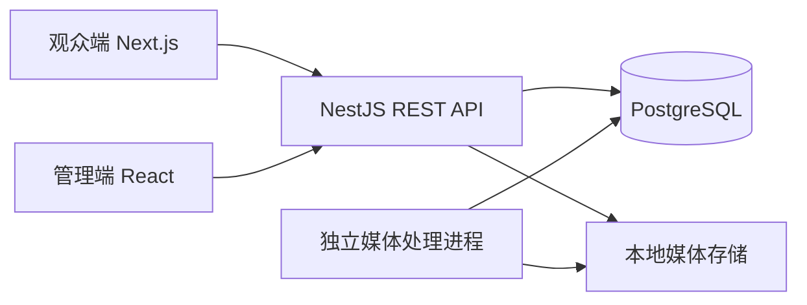

# 技术选型与本地开发规划

版本：v0.7 技术建议稿  
日期：2026-11-18  
状态：数据库、API 与后台页面的基础能力已实施；首页运营配置和公开聚合接口已补充，观众端首页、分类、详情与播放页面通过公开接口读取内容。其他业务功能仍按规划推进。数据库使用方法见 [本地数据库说明](../backend/api/README.md)。

## 1. 目标与推荐结论

面向海外观众，支持一剧多集与连载、免费内容免登录观看、观众端多语言且英文优先，以及添加手机主屏幕入口。后台中英文，并纳入批量上传、审核转码、积分策略与试看配置、定时下架及播放/解锁/完播统计。实际积分解锁启用阶段待确认，购买积分、支付与广告保留后期方向。

最新业务基线见 [业务规则确认稿](../requirements/08-first-release-business-rules.md) 与 [页面清单](../requirements/09-page-inventory.md)。仅以上下架控制公开；下架不主动中断已有观看，新打开受下架限制。技术方案须遵循该规则，不沿用独立外放开关。

推荐使用 TypeScript 贯穿观众端、管理端与服务端；以一个代码仓库管理多个应用，业务接口集中在一个模块化后端。当前不拆微服务。

技术选型由本轮需求推导，属于建议，并非所有组件已获用户逐项确认。用户尚未提供已有技术栈或团队经验；若已有积累，可在初始化前调整。

## 2. 技术选型

| 部分 | 推荐技术 | 本项目中的职责与理由 |
| --- | --- | --- |
| 语言与运行时 | TypeScript、Node.js 24 LTS 的受维护补丁版本 | 统一开发语言，利用当前电脑已有 Node 24 环境；初始化时核对补丁版本 |
| 仓库管理 | pnpm workspace | 统一管理观众端、管理端、接口与少量共享定义；先不引入额外构建编排平台 |
| 观众前端 | React、Next.js App Router、Tailwind CSS | 构建移动端网站、短剧列表与详情，使用服务端渲染和元信息能力支持内容被检索与分享 |
| 管理界面 | React、Vite、Ant Design | 后台以表格、表单、上传和状态操作为主，独立管理页面与观众页面的发布节奏 |
| 服务端 | NestJS，先使用 Express 适配器，提供 REST API | 集中处理登录、内容、语言数据、审核与处理任务、上下架/定时任务、观看资格和统计；按阶段接入交易 |
| 数据库 | PostgreSQL 18 的受维护补丁版本 | 本地与后期部署沿用同类数据库，支持关系约束、事务和后续交易记录 |
| 数据访问 | Prisma ORM，初始化时锁定兼容的稳定主版本与依赖 | 管理类型化数据访问与迁移；具体版本需与 Node、PostgreSQL、NestJS 项目配置联合验证 |
| 多语言 | 观众端 next-intl；管理端 react-i18next 与 Ant Design locale | 翻译界面 UI；当前语言传给后端，业务内容直接展示接口返回数据；后台中英文 |
| 主屏幕入口 | Next.js manifest 与图标，按浏览器提供添加引导 | 满足保存首页入口；按需要加入最小 Service Worker，不缓存受限内容或视频 |
| 本地媒体 | 本地文件目录、ffprobe、FFmpeg、浏览器原生 video | 输入MP4/50个/1GB，自动处理至单兼容版本最高1080p，封面、续传与有限重试/取消；编码参数和容量实施验证，本地不依赖云视频服务 |
| 检查与验证 | ESLint、TypeScript 检查；业务关键路径测试；Playwright 浏览器验收 | 重点覆盖权限、外放限制、语言切换与上传播放闭环；具体工具配置在初始化时确定 |

具体版本统一见 [技术版本基线](technology-versions.md)，已核对发布元数据与主要兼容声明。初始化时按基线固定直接依赖，并实际验证构建、迁移及运行，不把 `latest` 作为安装参数。数据库阶段已生成统一锁文件。

选型依据见文末官方文档；“适合本项目”属于根据当前范围作出的判断，不是官方对本项目的背书。

## 3. 应用关系与职责



- 观众端处理页面、多语言和播放器；服务端渲染时可访问接口，但不直接读取业务数据库。
- 管理端负责后台操作界面。登录、审核、发布与上下架的最终判断都由接口执行，不另设外放控制字段。
- 接口是内容与权限规则的唯一业务入口，避免观众端和管理端分别实现一套发布判断。
- 已上架剧目保留线上生效版本与待发布修改稿；公开读取生效版本，后台保存不直接改写线上资料或剧级策略，具体版本存储和发布切换在后续设计中确定。
- 视频检测、转码与封面处理使用独立进程，避免占用请求处理；上传、审核与转码分别保存状态，支持批量部分成功和失败重试。
- 分集标题、价格、试看与视频修改也保留待发布稿，发布生效后新观看使用新版本，既有观看不被强制切换；旧资源保留周期和回收待媒体任务设计，不将其理解为永久保留全部历史文件。
- 后期积分、订单和观看权益先作为同一后端中的业务模块，便于在同一数据库中处理一致性。

这套方案需要本地运行三个应用，初始配置比单一全栈应用多；代价换来明确的管理界面和业务接口边界。当前按后续支付与权限扩展的需求推荐此方案，尚无理由拆成多个业务服务。

## 4. 目录规划

以下为目标工程结构。当前数据库、后台 API、管理页面与观众端已建立；实际目录以仓库内容为准。

```text
red-video/
├── Agent.md
├── requirements/             # 产品需求、规则与验收
├── docs/
│   ├── technical-plan.md      # 本文件
│   └── technology-versions.md # 精确版本与兼容约束
├── frontend/                 # Next.js 观众网站
│   ├── src/app/[locale]/     # 带语言的页面路由；首页首版已建立
│   ├── src/components/       # 首页横幅、短剧卡片和筛选等
│   ├── src/i18n/             # 语言路由与配置
│   └── messages/             # 英文及其他已启用语言资源
├── backend/
│   ├── admin/                # React + Vite + Ant Design 管理界面
│   └── api/                  # NestJS 接口与媒体任务入口
│       ├── src/modules/      # 内容、分集、分类、标签、登录、媒体
│       └── prisma/           # 数据定义与迁移，尚未设计
├── packages/
│   └── shared/               # 按实际需要共享语言清单、类型与错误码
├── storage/                  # 仅本地使用，不提交视频或临时文件
└── pnpm-workspace.yaml       # 初始化时创建
```

`packages/`、`storage/` 及其他尚未创建的应用子目录仍为规划。共享包只放实际需要跨应用使用的定义，不共享后端数据库实体到浏览器。

## 5. 本地开发环境

### 5.1 前期本机只读检查结果

以下为实施前记录；数据库阶段实际使用 Node 24.22.3、Corepack pnpm 10.34.8，已安装并启动 PostgreSQL 18.7。

| 项目 | 2026-11-18 检查结果 | 规划 |
| --- | --- | --- |
| 机器架构 | macOS 环境、arm64 | 按 Apple Silicon 本地开发 |
| Node.js | v24.12.0 | 规划更新至基线 24.22.3，本轮未更新 |
| pnpm | 10.11.0 | 无需升至 12；建议更新到基线 10.34.8，本轮未更新 |
| npm | 11.6.2 | 已存在，工程统一使用 pnpm |
| Homebrew | 6.0.15 | 可用于后续安装本地系统工具 |
| PostgreSQL 命令 | 当前 PATH 未发现 `psql` | 需检查是否已在其他位置安装，再准备本地数据库 |
| FFmpeg | 当前 PATH 未发现 `ffmpeg` | 媒体处理阶段需要准备 |
| Docker | 当前 PATH 未发现 `docker` | 不作为首期本地启动前提 |

PATH 未发现不等于机器上绝对未安装。实施前先确认现有服务与端口，避免重复安装。

### 5.2 本地运行方式建议

优先在本机运行 Node 应用与 PostgreSQL，减少初期环境层数。PostgreSQL 可通过 Homebrew 准备；如后续需要团队统一环境，再补充容器配置，应用代码沿用。

以下为环境准备的参考命令；数据库阶段已安装并启动 PostgreSQL，FFmpeg 尚未安装：

Homebrew 安装时取所选公式当时提供的版本，不能仅凭下面的命令保证未来仍得到本次基线。实际安装后需核对版本；若版本已变化，更新版本记录并验证，不静默更换。

```sh
brew install postgresql@18
brew services start postgresql@18
brew install ffmpeg
```

PostgreSQL 是独立服务，还需确认其二进制路径，并为项目建立专用本地数据库与账号；不把真实凭据写入文档。工程中的连接地址、媒体目录、会话配置通过环境变量管理，提供不含密钥的示例文件。

| 进程 | 规划地址 | 说明 |
| --- | --- | --- |
| 观众网站 | `http://localhost:3000` | 浏览、搜索、详情、播放与语言切换 |
| 管理界面 | `http://localhost:3001` | 登录、上传与内容运营 |
| 业务接口 | `http://localhost:4000` | 向两个界面提供业务能力 |
| PostgreSQL | `localhost:5432` | 仅用于本地项目数据；端口可配置 |
| 媒体处理进程 | 无需公开端口 | 与接口使用同一代码仓库，独立执行任务 |

浏览器到接口的本地请求建议由各前端开发服务器代理到接口，尽量按同源路径使用接口；若选择跨源请求，需明确受信来源与 Cookie 策略。后台建议使用服务端会话与 HttpOnly Cookie，会话记录先存 PostgreSQL，避免依赖进程内存；配合有状态操作的请求来源与 CSRF 校验。登录状态不依赖公开存储中的长期令牌。

### 5.3 手机联调与主屏幕验证

电脑浏览器里的 `localhost` 与手机上的 `localhost` 不是同一台机器。手机页面、媒体地址和代理目标要统一使用手机可访问的开发站点，不能在返回的播放地址中写死电脑的 `localhost`。

普通页面和播放可先在同一局域网联调；涉及安全上下文的 PWA 能力，应通过手机信任的本地 HTTPS 开发站点验证。手机访问电脑局域网 HTTP 地址，不自动享受电脑 `localhost` 的安全上下文例外。不因桌面模拟通过就判定手机添加主屏幕已验收，也不为联调默认公开数据库或后台。

## 6. 多语言方案

### 6.1 已确认范围与待定范围

- 已确认：观众端界面多语言，英文优先；后台首期使用中文、英文两套。
- 待确认：观众端首批非英文语言。后台中文建议先按简体中文 `zh-CN` 规划，英文使用 `en`，简繁范围尚未单独确认。
- 已确认业务语言边界：前端把 i18n 当前语言传给后端，剧名、简介、分类与标签等直接展示接口返回数据，前端只翻译 UI。
- 已确认剧名/简介发布需英文，其他语言由后台按需维护，缺译由后端回退英文；内容编辑语言与后台 UI 语言分开。分类标签维护与回退仍待统一，字幕音轨为独立能力。

### 6.2 实施建议

1. 观众端用 next-intl，将文字放入语言资源文件；英文资源优先完整，其他语言按确定清单交付。
2. 建议 URL 包含语言前缀，例如 `/en`、`/en/dramas/...`；其他前缀只有对应语言启用后才开放，不能为缺少内容的语言批量生成可索引空页。
3. 建议无明确选择时默认英文；明确的语言链接和用户主动选择优先，不按浏览器语言强制覆盖。网站根路径进入默认或用户已选择的语言版本。
4. 页面文字、元信息、空状态与错误提示共同覆盖翻译。缺少翻译时回退英文，并在检查中暴露缺失项。
5. API 接收当前语言并返回对应业务展示数据，前端不再次翻译；缺失语言回退由后端统一确定。错误提示建议以稳定错误码由 UI 翻译。切换语言后重新取得受影响数据，缓存与查询应区分语言，分类标签关联保持稳定业务身份。
6. 时间与数字使用本地化格式；积分是整数概念，未来支付金额必须同时携带币种，不能从界面语言推导支付币种。
7. 添加手机主屏幕时使用稳定的应用身份，入口默认指向站点根路径，由网站恢复语言选择，避免每种语言安装成不同应用。具体浏览器行为需实机验证。

后台使用 react-i18next 管理中文和英文业务文案，并同步 Ant Design 组件语言，覆盖菜单、表格、表单校验、上传状态及错误提示。切换不应清空正在编辑的资料或中断上传。两个界面使用一致的语言编码，不要求用同一个框架插件；后台具备中文资源不代表观众端已确定上线中文。

## 7. 视频上传、存储与播放

### 7.1 本地首期建议

- 数据库存资料、分集、权限与媒体引用，视频文件放在项目本地存储目录，不存进数据库，不提交到代码仓库。
- 已确认输入为 MP4，每批最多50个、单文件不超过1GB，可配置；上传前识别明确集号并确认映射，不明/重复/超计划先处理，既有集号不自动覆盖。扩展名不等于真实媒体有效，也不承诺任意编码均可解码。
- 上传完成自动用 ffprobe 检测并排队 FFmpeg 处理；输出目标为一个 H.264/AAC 兼容 MP4、最高1080p、保留横竖比例且不放大，暂不多清晰度。封面支持自动候选及指定时刻截帧，替换剧封面另行确认。缩放/码率/音轨、支持编码和机器容量实施验证。
- 播放器首期使用原生 `video` 控件，覆盖播放、暂停、进度与全屏；本地媒体响应支持 Range 请求，避免拖动进度时每次下载整个文件。
- 已确认分片断点续传，站内切页上传继续，从当前剧集管理返回上传页查看进度，刷新/关闭后重选同一原文件续传；2026-11-19 已取消独立全局媒体任务入口。建议流式/临时文件接收，不整片读入内存。同文件识别、分片存储、有效期与校验在技术设计落实。
- 私有原文件不直接放进 Next.js 的 `public/`。新打开按剧目与分集上下架状态检查；已经开始的观看需继续获得该次观看的媒体加载，不因下架被主动中断。会话识别、有效期和刷新/切集边界待细化，不能简单地拒绝一切后续 Range 或分片请求。
- 试看是正片开头 X 秒，默认 30 秒可覆盖/关闭，运营不额外上传试看视频。媒体方案可生成受限试看资源或采用等效服务端限制；不能向无权益用户提供完整付费资源，再只靠客户端到点暂停。
- 已上传后的处理独立于浏览器，任务状态持久化；临时错误最多额外自动重试2次，仍失败人工重试失败阶段，损坏/不支持直接提示，保留成功项。该剧全部批次可查，每批取消未完成项先取消中、确认停止才已取消，不删除完成素材或撤回线上。进程恢复/迟到结果与重试计数实现后续设计，初期仍单处理进程，不提前引入分布式队列。

媒体处理成功和审核结论通过均不自动上架。审核工作台按提交对象版本记录和对比，结论含原因、操作人、时间及历史；完整审批角色和流转仍待定义。B-07 按发布目标和关联影响校验有效审核及媒体/配置，阻断与提醒分开，合格独立目标可明确部分发布，共享依赖不可绕过。实际发布应复核最新版本并防重复，具体一致性机制后续设计。

### 7.2 后期扩展路径

上线前再按地区、流量、视频时长和预算选择对象存储、视频服务与 CDN。本地与远程存储通过媒体引用与存储适配层衔接，避免数据库绑定本机绝对路径。

需要更好的弱网或长视频体验时，再增加 HLS 多码率输出；浏览器支持时使用原生 HLS，否则评估 hls.js。HLS、CDN 和短时播放地址并不等于 DRM，也不能撤回已经发送到设备的数据。

不建议将本地 Node 进程转发视频的方式直接视为海外生产分发方案；生产分发需要独立评估带宽、费用与访问限制。

## 8. 后期积分、支付与广告的边界

- 积分与订单：由同一业务接口和 PostgreSQL 管理；扣积分、记录流水和发放权益须以事务、一致性约束和防重复处理共同保证，不能只写一个余额字段。
- 后台积分策略、单集价格和试看配置当前已纳入产品范围；真实扣积分与权益启用阶段待定。因下架失败的当次操作不产生净扣分；并发下架与解锁的成立时点、回滚补偿需在页面及交易逻辑中细化。
- 定时下架范围和业务时区已确定为整剧/单集、逐条设置与北京时间 Asia/Shanghai，支持计划查看/修改/取消；保存与执行时需保持时刻含义一致，不因后台中英文切换改变任务时间，执行架构后续设计。
- 支付：由后端确认支付结果，不能以浏览器显示“成功”直接发积分；供应商根据公司主体、目标地区、币种和业务范围再选，本轮不默认接入某一家。
- 广告：观众网站负责展示，后端维护需要的开关和配置；激励广告只有在联盟支持网页场景且奖励规则确认后再做。
- 测试阶段使用模拟结果或供应商测试环境，不依赖真实收款；这些模块本轮不创建。

## 9. 首期暂不引入的技术

Redis、分布式队列、Elasticsearch、微服务、Kubernetes、原生 App 与复杂视频保护暂不作为初始依赖。模糊搜索先按当前语言在 PostgreSQL 验证；部分匹配、错字容错、搜索字段和排序须先冻结产品口径，再决定是否需要额外索引能力或搜索服务。

SQLite 也能处理本地事务，但当前建议直接使用 PostgreSQL，以便提前验证未来部署时采用的数据库行为；不为节省一次本地安装而规划后续再更换数据库。

## 10. 后续实施顺序

数据库、后台 API、管理页面与观众端主链路已实现；付费账户、支付和统计等业务按后续需求推进。以下是更长期的实施建议。

1. 依据版本基线确认技术方案与首批语言范围，准备 Node、pnpm、PostgreSQL、FFmpeg 环境。
2. 初始化 workspace、观众端、管理端和接口，配置环境示例与类型检查，验证三端和数据库连通。
3. 打通最小内容路径：后台登录 → 建剧 → 上传与处理分集 → 审核/预览/校验 → 上架 → 观众免登录观看免费内容；同时验证下架后的新打开限制与已有观看保护。
4. 完善分类、标签、搜索、多语言和异常状态；后台验收中英文，观众端待其他语言清单确定后验收实际交付的英文与非英文版本。
5. 进行手机播放和添加主屏幕实机验证，确认本地闭环后，再单独规划上线与商业化。

## 11. 官方资料与核对边界

核对日期：2026-11-18。资料用于支持框架能力和环境判断，实际依赖版本及平台兼容性需在初始化时再次验证。

- [Node.js 版本状态](https://nodejs.org/en/about/previous-releases)：Node 24 当前属于 LTS；本方案未要求追随最新主版本。
- [Next.js 安装](https://nextjs.org/docs/app/getting-started/installation)、[PWA 指南](https://nextjs.org/docs/app/guides/progressive-web-apps)：本地运行与 manifest、图标和安装体验。
- [next-intl 路由配置](https://next-intl.dev/docs/routing/configuration)：语言清单、默认语言与路由策略。
- [NestJS 文件上传](https://docs.nestjs.com/techniques/file-upload)：所选 Express 上传能力；若更换适配器需重新核对上传实现。
- [Ant Design 与 Vite](https://ant.design/docs/react/use-with-vite/)、[react-i18next](https://react.i18next.com/)：管理界面的构建与业务文案国际化。
- [PostgreSQL macOS 支持](https://www.postgresql.org/download/macosx/)、[Homebrew PostgreSQL 18](https://formulae.brew.sh/formula/postgresql@18)、[FFmpeg](https://formulae.brew.sh/formula/ffmpeg)：本地环境准备。
- [Prisma PostgreSQL 支持](https://www.prisma.io/docs/orm/v7/core-concepts/supported-databases/postgresql)、[事务能力](https://www.prisma.io/docs/orm/fundamentals/transactions)：不同主版本资料与 API 不混用，实施时以锁定版本的文档为准。
- [FFmpeg 格式文档](https://ffmpeg.org/ffmpeg-formats.html)、[hls.js 官方仓库](https://github.com/video-dev/hls.js)：媒体处理与后续 HLS 评估入口。
- [MDN Range 请求](https://developer.mozilla.org/en-US/docs/Web/HTTP/Guides/Range_requests)：媒体按范围加载的能力说明。
- [MDN 安全上下文](https://developer.mozilla.org/en-US/docs/Web/Security/Defenses/Secure_Contexts)：区分本机 localhost 与手机访问局域网地址时的能力限制。
- [pnpm workspace](https://pnpm.io/workspaces)：单仓库管理多个应用。
